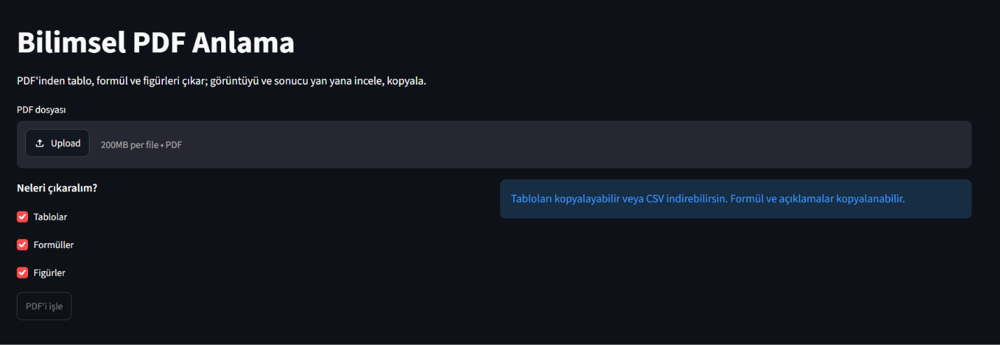
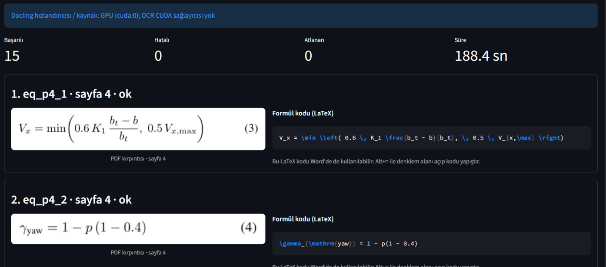

# Bilimsel PDF Anlama

Bilimsel makalelerdeki **tabloları, matematiksel formülleri ve figürleri** bulup anlaşılır çıktılara dönüştüren bir Python projesidir. PDF'teki öğelerin yerleri [Docling](https://github.com/docling-project/docling) ile tespit edilir; kırpılan tablo, formül ve figür görüntüleri bir görsel dil modeline (VLM) gönderilerek okunur veya açıklanır.

> **Uyarı:** Bu proje bir bilimsel doğrulama sistemi değildir. Model çıktılarının doğruluğu garanti edilmez; önemli sonuçlar makalenin kendisiyle karşılaştırılmalıdır.

## Ekran görüntüleri





## Özellikler

- **Tablolar:** Markdown veya HTML olarak çıkarılır, arayüzde incelenir ve CSV olarak indirilebilir.
- **Formüller:** LaTeX koduna dönüştürülür, Word denklem alanında kullanılabilir.
- **Figürler:** Türü, eksenleri ve ana çıkarımı Türkçe olarak açıklanır.
- **Kaynakla karşılaştırma:** Her çıktı, PDF'ten alınan kırpıntıyla yan yana gösterilir.
- **Sayfa seçimi:** Tüm PDF veya yalnızca seçilen sayfalar işlenir; daha önce işlenen sayfa ve içerik türleri tekrar işlenmez.
- **İki kullanım şekli:** Streamlit arayüzü ve komut satırı.
- **İki VLM sağlayıcısı:** Gemini (varsayılan) veya yerel Ollama.

## İş akışı

1. PDF sayfaları Docling ile okunur ve belge yapısı JSON olarak kaydedilir.
2. Tablolar, formüller ve figürler; sayfa, konum ve okuma sırasıyla belirlenir.
3. Belirlenen alanlar PDF'ten PNG olarak kırpılır.
4. VLM tabloları Markdown/HTML'e, formülleri LaTeX'e dönüştürür ve figürleri Türkçe açıklar.
5. Sonuçlar doğrulanıp `outputs/results/` altına yazılır ve arayüzde gösterilir.

Belirli sayfalar seçildiğinde işlenen sayfa ve içerik türleri `outputs/results/<id>/processed_pages.json` dosyasında tutulur. Sonraki çalıştırmada yalnızca yeni sayfalar veya eksik içerik türleri işlenir, önceki sonuçlar korunur.

## Kurulum

Python 3.12 ile test edilmiştir.

```powershell
python -m venv venv
.\venv\Scripts\Activate.ps1

# NVIDIA GPU varsa önce CUDA'lı PyTorch'u kur (GPU yoksa bu satırı atla)
pip install torch torchvision --index-url https://download.pytorch.org/whl/cu128

pip install -r requirements.txt
```

Normal `pip install` Windows'ta çoğunlukla **CPU sürümü** PyTorch kurar. GPU kullanmak istiyorsan yukarıdaki PyTorch satırını `requirements.txt`'ten önce çalıştır. Komut, sürücüne uygun CUDA sürümüyle değişebilir; güncel komut için [pytorch.org](https://pytorch.org/get-started/locally/) sayfasına bak.

GPU kontrolü:

```powershell
python -c "import torch; print(torch.cuda.is_available())"
python -c "import onnxruntime; print(onnxruntime.get_available_providers())"
```

- İlk komut `True` dönmelidir.
- İkinci komutta `CUDAExecutionProvider` yoksa OCR CPU'da çalışır; bu bir hata değildir.
- `onnxruntime` ve `onnxruntime-gpu` aynı anda kurulu kalmamalıdır.

### VLM sağlayıcısı

Proje kökünde bir `.env` dosyası oluştur (`.env.example` dosyasını kopyalayabilirsin):

```powershell
Copy-Item .env.example .env
```

**Gemini (varsayılan):**

```
GEMINI_API_KEY=anahtarini_buraya_yaz
GEMINI_MODEL=model_adi        # isteğe bağlı
VLM_MIN_GAP_SECONDS=4         # isteğe bağlı, istekler arası bekleme (sn)
```

Gemini istekleri arasında varsayılan olarak 4 saniye beklenir. `VLM_MIN_GAP_SECONDS=1` gibi daha kısa bir değer hızı artırabilir, ancak API hız sınırına takılma ve otomatik tekrar denemeleri nedeniyle toplam süreyi uzatabilir.

**Yerel Ollama:**

```
VLM_PROVIDER=ollama
OLLAMA_MODEL=model_adi
```

Ollama uygulaması çalışır durumda olmalı ve belirtilen model indirilmiş olmalıdır. Ollama yerel çalıştığı için istekler arası bekleme uygulanmaz.

> **Önemli:** `.env` dosyasını paylaşma ve sürüm kontrolüne ekleme.

## Kullanım

### Streamlit arayüzü

```powershell
streamlit run src/app.py
```

PDF'i yükle, işlenecek sayfaları ve içerik türlerini (tablo, formül, figür) seçip **PDF'i işle** düğmesine bas. Arayüze yüklenebilecek PDF üst sınırı 100 MB'tır.

İşlem özetinde Docling'in GPU mu, CPU mu yoksa daha önce kaydedilmiş JSON mu kullandığı gösterilir. Windows Uygulama Denetimi (Smart App Control) Docling'in CUDA kitaplığını `WinError 4551` ile engellerse uygulama CPU'da yeniden dener; bu durumda işlem daha yavaş olabilir.

### Komut satırı

Tek PDF:

```powershell
python src/run.py "data/pdf/1602.03837.pdf" --extract tables,equations,figures --format csv,md
```

Birden fazla PDF veya dosya deseni:

```powershell
python src/run.py "data/pdf/*.pdf" --extract tables --format csv,md --limit 3
```

- `--extract`: `tables`, `equations`, `figures`
- `--format`: `csv`, `md`, `json` (`result.json` her çalıştırmada kaydedilir; `csv` ve `md` ek dışa aktarma dosyalarını belirler)
- `--limit`: İşlenecek PDF sayısı (0 = sınır yok)

PDF dosyaları `data/pdf/` klasöründe bulunmalıdır. Komut satırında sayfa seçimi yoktur; bu özellik Streamlit arayüzüne aittir.

## Sonuçlar nerede saklanır?

| Klasör | İçerik |
|---|---|
| `outputs/baseline/` | Docling'in belge yapısı JSON'u. Tekrar Docling çalıştırmamak için kullanılır. |
| `outputs/crops/` | Modelin okuduğu tablo, formül ve figür görüntüleri. |
| `outputs/cache/` | VLM yanıtlarının önbelleği. Silinebilir; aynı istekler modele yeniden gönderilir. |
| `outputs/results/<id>/` | `result.json`, sayfa işleme kaydı ve dışa aktarılan dosyalar (`tables/`, `equations/equations.tex`, `figures/`, `makale_sirali.md`). |

`outputs/results/` silinirse önceki sonuçlar ve sayfa bazlı işleme geçmişi kaybolur. Bu klasörlerin tamamı uygulamanın ürettiği çalışma verisidir.

## Kod yapısı

| Dosya / klasör | Sorumluluk |
|---|---|
| `src/app.py` | Streamlit arayüzü, PDF yükleme ve sonuç gösterimi |
| `src/run.py` | Komut satırı ve arayüzün kullandığı ana işleme hattı |
| `src/integrations/docling_client.py` | Docling dönüşümü ve hızlandırıcı (GPU/CPU) seçimi |
| `src/integrations/vlm_client.py` | Gemini/Ollama bağlantısı, istek sınırlama, önbellek ve yeniden deneme |
| `src/extraction/extract_items.py` | Docling çıktısında tablo/formül/figür konumlarını bulma |
| `src/extraction/extract_table.py` | Tablo istemi ve çıktı ayrıştırma |
| `src/extraction/extract_equation.py` | Formül istemi, LaTeX temizleme ve biçimsel kontroller |
| `src/extraction/describe_figure.py` | Figür istemi ve atlama/uyarı mantığı |
| `src/cropping/crop_items.py` | Sayfa alanlarını PNG kırpıntısına dönüştürme |
| `src/models/schemas.py` | Pydantic sonuç modelleri |
| `src/exporting/export.py` | CSV, Markdown, HTML, LaTeX ve figür dışa aktarma |
| `scripts/` | Örnek PDF indirme, toplu Docling ön işleme, sonuç inceleme |
| `tests/` | Elle çalıştırılan kontroller |

## Testler

Tablo ayrıştırma mantığını hızlıca kontrol etmek için (API çağrısı yapmaz):

```powershell
python -m tests.test_table
```

Tüm satırlar `PASS` olmalıdır. `tests.test_vlm` ve `tests.test_cache` **gerçek model isteği** gönderebilir; çalıştırmadan önce sağlayıcı yapılandırmasını ve olası maliyeti göz önünde bulundur.

## Docker ile çalıştırma

Yayımlanmış imaj: `erenaltun/pdf-anlama:latest`

`compose.yaml` ve `.env.example` dosyalarını aynı klasöre koy, `.env.example` dosyasını `.env` olarak kopyalayıp kendi `GEMINI_API_KEY` değerini gir ve çalıştır:

```powershell
Copy-Item .env.example .env
docker compose up -d
```

Arayüz `http://localhost:8501` adresinde açılır.

- Durumu görmek için: `docker compose ps`
- Günlükler için: `docker compose logs -f`
- Durdurmak için: `docker compose down` (sonuçları da silmek için `docker compose down -v`)
- Güncellemek için: `docker compose pull` ardından `docker compose up -d`

API anahtarı imaja dahil edilmez; Compose çalışma anında `.env` değerlerini konteynere aktarır. Ollama için `.env` içinde `VLM_PROVIDER=ollama` yap ve `OLLAMA_HOST` değerini konteynerden erişilebilir adrese ayarla (Docker Desktop'ta varsayılan: `http://host.docker.internal:11434`).

Bu imaj Streamlit arayüzünü çalıştırır. GPU hızlandırması Docker host'undaki NVIDIA sürücüsü, container runtime ve Docling/ONNX yapılandırmasına bağlıdır; yalnızca Docker Compose ile GPU kullanımı garanti edilmez.

## Sınırlılıklar ve gizlilik

- Görsel dil modelleri hücre değerlerini yanlış okuyabilir, sembol veya indis atlayabilir, grafikleri hatalı yorumlayabilir. Biçimsel kontroller (parantez dengesi, sütun sayısı vb.) içeriğin doğru olduğunu kanıtlamaz.
- Taranmış veya düşük çözünürlüklü PDF'lerde, karmaşık tablolarda, sayfalar arası devam eden tablolarda ve yoğun formüllerde öğe tespiti ve kırpma kalitesi düşebilir.
- **Gemini gibi harici bir sağlayıcı seçildiğinde kırpılan görüntüler sağlayıcıya gönderilir.** Hassas veya yayımlanmamış belgeleri işlemeden önce sağlayıcının veri işleme koşullarını değerlendir. Gizlilik gerekiyorsa yerel Ollama tercih edilebilir.
- Süre; donanıma, PDF'e, model sağlayıcısının hız sınırlarına ve ağ durumuna bağlıdır. Bu projede sabit bir hız veya doğruluk değeri iddia edilmemektedir.

## Makale

Projenin ayrıntılı tanıtımı için: [Bilimsel PDF Anlama (PDF)](docs/Bilimsel_PDF_Anlama_Makale.pdf)

## Lisans

Lisans bilgisi için `LICENSE` dosyasına bakın.
